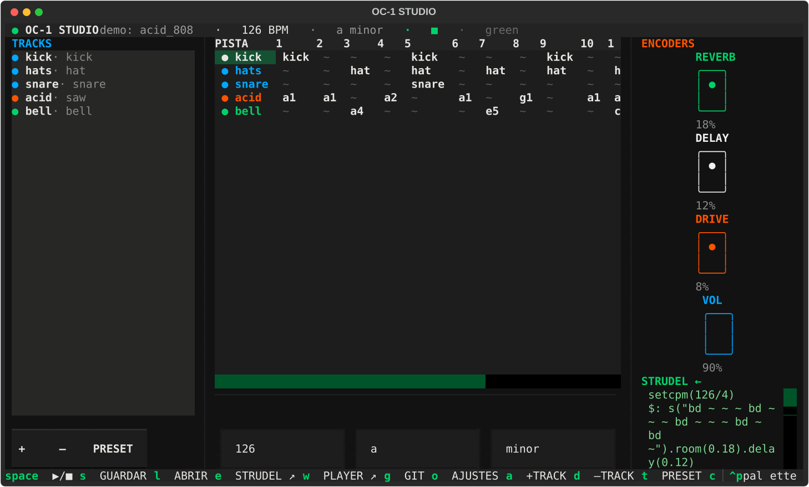

# OP-1 STUDIO

**¿Nuevo con la terminal y vienes de Ableton/FL/GarageBand?**
Empieza por 👉 **[docs/GUIA-PRINCIPIANTES.md](docs/GUIA-PRINCIPIANTES.md)** —
instalación y uso paso a paso, sin jerga, con equivalencias DAW ↔ OP-1 STUDIO.

Estudio de música **en la terminal** con estética **Teenage Engineering** (OP-1):
secuenciador de 16 pasos, encoders ASCII, **temas dinámicos** que siguen la
apariencia de tu sistema (claro/oscuro), demos guardados como **archivos `.py`
editables**, **puente a Ableton Live vía Max for Live** y **integración git**
para clonar, guardar cambios y subirlos a GitHub.



```
● OP-1 STUDIO   demo: chip_boy   ·   140 BPM   ·   e minor   ·   ■   ·   white   ·   LIVE 07/16
 ┌ TRACKS ───────┐ ┌ SECUENCIADOR ─────────────────────────┐ ┌ ENCODERS ─┐
 │ ● kick · kick │ │ PISTA │ 1  2  3  4  5  6 …            │ │ REVERB    │
 │ ● pulse · sq  │ │ ● kick│ kick ~ ~ ~ kick ~ kick …      │ │ ╭───╮ 18% │
 │ ● arp · pluck │ │ ● arp │ e4 b4 e5 ~ d5 b4 g4 …         │ │ DELAY     │
 └───────────────┘ └───────────────────────────────────────┘ └───────────┘
```

## Instalación

```bash
cd op1-studio
python3 -m venv .venv
.venv/bin/pip install -e .          # única dependencia: textual
```

Requisitos: Python ≥ 3.10, git (opcional), reproductor del sistema
(`afplay` en macOS, `aplay/paplay` en Linux, PowerShell en Windows) y,
para el modo LIVE, Ableton Live con Max for Live.

## Uso

```bash
op1studio                       # interfaz TUI (o: python -m op1studio)
op1studio play demos/demo_chip_boy.py      # renderiza y suena (sintetizador local)
op1studio code demos/demo_acid_808.py      # imprime el código Strudel
op1studio strudel demos/demo_acid_808.py   # abre strudel.cc con el demo cargado
op1studio strudel --page demo.py           # player local con REPL Strudel embebido
op1studio new "mi-beat" [--chip]           # crea demos/mi-beat.py
op1studio live demos/demo_acid_808.py      # puente LIVE headless (Ableton)
op1studio list                             # lista los demos
```

### Teclas de la TUI

| Tecla      | Acción                          |
|------------|---------------------------------|
| `espacio`  | ▶/■ render + play (local)       |
| `v`        | LIVE on/off (Ableton vía Max)   |
| `s`        | guardar demo como `.py`         |
| `l`        | abrir demo                      |
| `e`        | abrir en **strudel.cc** (share) |
| `w`        | player local con Strudel (web)  |
| `g`        | panel **git**                   |
| `o`        | ajustes (apariencia, color, puertos…) |
| `a` / `d`  | añadir / borrar pista           |
| `t`        | aplicar preset a la pista       |
| `c`        | cambiar acento de color (TE)    |
| `↑/↓` en encoder | girar el encoder          |
| `⏎` en la pista o celda | editar patrón      |
| `q`        | salir                           |

Ctrl+P abre la paleta de comandos de Textual.

## Temas dinámicos

En Ajustes (`o`) → **APARIENCIA**: `auto (sistema)` · `oscuro` · `claro`.
En `auto`, la interfaz detecta el modo claro/oscuro de tu sistema
(macOS `AppleInterfaceStyle`; GNOME via `gsettings`) y cambia solo,
sondeando cada 5 s. Cada acento (naranja, azul, verde, blanco) tiene su
variante clara estilo "OP-1 field": fondo blanco hueso y tinta grafito.

## Los demos son archivos `.py` editables

```python
from op1studio.demo import Demo, Track

demo = Demo(
    title="chip_boy",
    bpm=140,
    key="e", scale="minor",
    style="chip",                      # 'clean' | 'chip' (computadora vieja)
    tracks=[
        Track(name="pulse", sound="square",
              pattern="e2 ~ e2 e3 ~ e2 ~ d2 ~ e2 ~ g2 ~ e2 ~ b2 ~", gain=0.6),
    ],
    fx={"reverb": 0, "delay": 0.22, "drive": 0.15, "volume": 0.9},
)
```

* `pattern`: **un token por semicorchea**; `~` o `.` = silencio.
* Notas: `c3`, `c#3` (sostenido), `bb3` (bemol). Percusión: `kick snare hat clap`.
* Sonidos: `sine square saw tri pluck bell fm noise kick snare hat clap`.

## Dos estilos de sonido

* `style="clean"`: osciladores clásicos, kick analógico, reverb de comb.
* `style="chip"` (**computadora vieja / 8-bit**): pulsos con duty del 25 %,
  ruido de 1 bit, kick de onda cuadrada, decimación del reloj a ~7 kHz,
  cuantización a 24 niveles y eco tipo Game Boy. En Strudel se traduce a
  ondas cuadradas con `.coarse(8).crush(4)` (verificado en el REPL).

## Puente a Ableton Live (Max for Live)

OP-1 STUDIO actúa como **secuenciador + interfaz**, y Ableton suena los
instrumentos que pongas en la pista. Comunicación por UDP (localhost):

```
OP-1 → Max : "op1 note <midi> <vel>"   (percusión mapeada a GM: kick 36, snare 38, hat 42, clap 39)
Max → OP-1 : "op1 clock <0-15>"        (reloj de 16avos sincronizado con el transporte de Live)
```

### Montaje (una vez, ~2 min)

1. En Ableton: pista MIDI → añade un **Max MIDI Effect** vacío.
2. Abre su patcher; en Max: File → Open → `max/op1-studio-bridge.maxpat`;
   selecciona todo (⌘A), copia (⌘C), pégalo en el patcher del dispositivo y
   guarda el dispositivo (⌘S). (También puedes cargar el `.maxpat` como
   patcher del dispositivo directamente.)
3. En OP-1 STUDIO pulsa `v` (LIVE) — o ejecuta `op1studio live <demo.py>`
   para usarlo sin interfaz.
4. Dale **play** en Ableton: el reloj de 16avos llega por UDP y OP-1 envía
   las notas de cada paso → suenan por el `midiout` del dispositivo, con
   el instrumento que tengas cargado en esa pista (sintetizador, drum rack…).

Qué hace el dispositivo Max: `udpreceive 7647 → route op1 → route note →
makenote 150 → pack → midiformat → midiout`, y el reloj:
`transport → round 120 → change → expr (int($f1/120.) % 16) → prepend
op1 clock → udpsend 127.0.0.1 7648`. Los puertos se cambian en Ajustes (`o`).

## Git / GitHub

```bash
op1studio git init                                   # convierte la carpeta en repo
op1studio git add-remote origin https://github.com/tu-usuario/op1-demos.git
op1studio git commit -m "demo: chip_boy"             # add -A + commit
op1studio git push                                   # almacena en GitHub
op1studio git pull                                   # baja cambios
op1studio git clone https://github.com/alguien/demos.git
```

En la TUI (tecla `g`): **STATUS / COMMIT / PUSH / PULL / REMOTE / CLONE /
INIT / LOG**, y en Ajustes el **auto-commit al guardar** versiona cada
cambio de tus demos. Autenticación GitHub: HTTPS + token o SSH.

## ¿OpenTUI?

[OpenTUI](https://opentui.com) es TypeScript/Zig y no corre dentro de un
programa Python, así que la interfaz usa **Textual** recreando la estética:
encoders ASCII giratorios, botones de tecla OP-1, temas claro/oscuro por
acento y sondeo del tema del sistema.

## Estructura

```
op1studio/
├── app.py           interfaz TUI (Textual, estética TE, temas dinámicos)
├── cli.py           línea de comandos (play/code/strudel/new/live/git)
├── demo.py          modelo Demo/Track (style clean|chip) + .py save/load
├── synth.py         motor local: osciladores + chip 8-bit → WAV → player
├── strudel.py       codegen Strudel (con coarse/crush) + share + player local
├── live_bridge.py   puente UDP ↔ Max for Live (notas + reloj)
├── system_theme.py  detección claro/oscuro del sistema
├── gitops.py        git: init/clone/commit/push/pull/remotes
├── settings.py      ~/.op1studio/config.json
└── theme.py         paleta Teenage Engineering (temas oscuros y claros)
max/op1-studio-bridge.maxpat   dispositivo Max for Live listo para pegar
demos/                         tus demos (.py)
```
